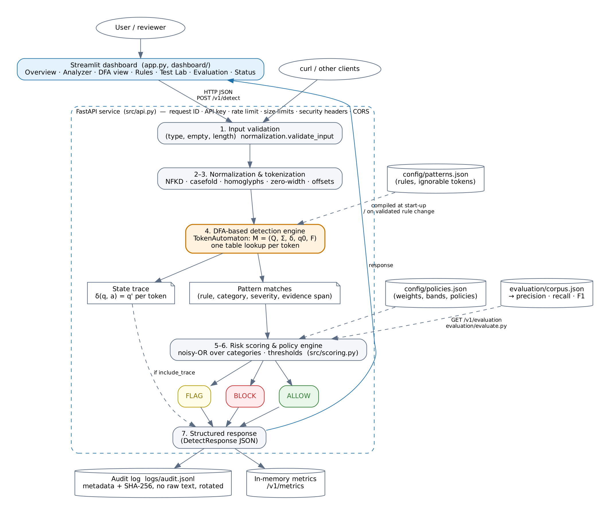
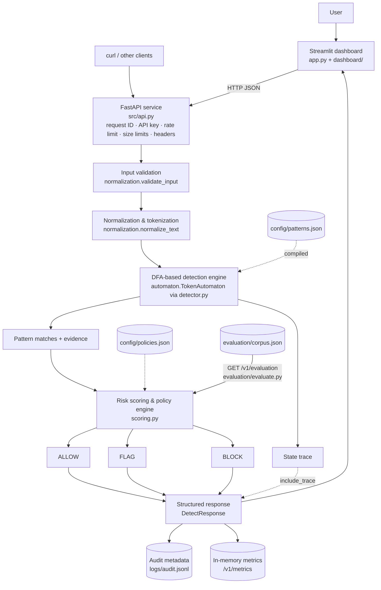

# Architecture



Image source: `docs/diagrams/architecture.dot`. Re-render with
`dot -Tpng -Gdpi=150 docs/diagrams/architecture.dot -o docs/diagrams/architecture.png`.
The same structure in Mermaid (renders on GitHub):



## Components and data flow

| Stage | Module | Input → output |
|---|---|---|
| HTTP layer | `src/api.py` | JSON request → `DetectRequest` (pydantic, `extra="forbid"`, strict types). Middleware assigns a request ID, checks `Content-Length`, adds security headers and logs one JSON line per request. Dependencies enforce the API key and rate limit. |
| 1. Input validation | `normalization.validate_input` | must be `str`, non-blank, ≤ `MAX_INPUT_CHARS` → `InputValidationError(code)` mapped to 413/422 |
| 2. Normalization | `normalization.normalize_text` | per character: drop zero-width, NFKD, drop accents, casefold, homoglyph map. Each output char keeps the index of its original char |
| 3. Tokenization | same function | regex `[^\W_]+('[^\W_]+)*` → `Token(text, start, end)` with offsets into the **original** text |
| 4. DFA recognition | `automaton.TokenAutomaton.run` (built by `detector.PromptInjectionDetector`) | token strings → `AutomatonMatch(pattern_id, start_pos, end_pos, state)` + optional `TraceStep`s |
| 5. Match extraction | `detector.PromptInjectionDetector.scan` | automaton matches → `Match(rule, category, severity, matched_text, char span, in_quotes)` |
| 6. Scoring | `scoring.compute_risk` | matches → score (noisy-OR over strongest rule per category), level, breakdown |
| 7. Policy | `scoring.decide` | score + severities + policy → ALLOW / FLAG / BLOCK + reasons |
| 8. Report | `service.DetectionService.analyze` | assembles the response, stage timings, explanations |
| 9. Audit & metrics | `audit.AuditLogger`, `metrics.MetricsRegistry` | metadata only (no raw text) → JSONL file / in-memory counters |

The **dashboard contains no detection code**. Every page calls the API through
`dashboard/client.py`. The **evaluation script** calls `DetectionService.analyze`
in-process, the same function the API uses, with `record=False` so it never pollutes the
audit log or metrics.

## Rule changes (copy-on-write)

```
PATCH/POST /v1/patterns
  → RuleSet.with_rule_enabled / with_added_rule   (full validation, raises on any problem)
  → PromptInjectionDetector(new_ruleset)           (compile a NEW automaton; may raise)
  → save_ruleset_atomic()                          (temp file + fsync + os.replace)
  → swap the live detector under a lock
  → audit event "ruleset_changed" (old/new fingerprint)
```

If any step fails, the previous detector keeps serving and the API returns 422.
In-flight scans keep using the detector they started with, because `analyze`
takes a snapshot reference. The ruleset fingerprint (SHA-256 of the canonical JSON)
appears in every response and audit record. Together with the detector version it
identifies exactly which automaton produced a result.

## Determinism

For identical input text and identical ruleset fingerprint, the following are
identical: tokens, the full state trace (same state numbers, thanks to BFS numbering
with sorted children), matches, score, level and action. Only `request_id`,
`timestamp` and timings differ (tested in `test_service_result_is_deterministic`
and `test_rebuilding_automaton_gives_identical_state_numbers`).

## Repository layout

```
app.py                     Streamlit dashboard (entry point)
dashboard/client.py        HTTP client for the API
dashboard/theme.py         CSS, colours, HTML helpers (all user text escaped)
dashboard/dfa_view.py      DOT graph of the visited sub-automaton
src/config.py              Settings from environment variables
src/normalization.py       validation, normalization, tokenization, quote spans
src/automaton.py           the DFA (trie, failure function, dense δ, run, trace)
src/rules.py               rule schema, validation, canonicalization, atomic save
src/detector.py            rules → automaton; automaton matches → evidence
src/scoring.py             risk score, risk level, policy decision
src/audit.py               JSONL audit log with rotation and input hashing
src/metrics.py             in-memory metrics, sliding-window rate limiter
src/models.py              API request/response schemas
src/service.py             pipeline orchestration, rule changes, readiness
src/evaluation.py          confusion matrix and metrics
src/api.py                 FastAPI app and endpoints
config/patterns.json       19 rules / 219 patterns / ignorable tokens
config/policies.json       weights, risk bands, strict / balanced / monitor policies
evaluation/corpus.json     90 labeled examples (dev 50 / heldout 40)
evaluation/evaluate.py     CLI evaluation report
tools/worked_example.py    generates the MOC report's tables and teaching diagram
tests/                     pytest suite
docs/                      this documentation
```
